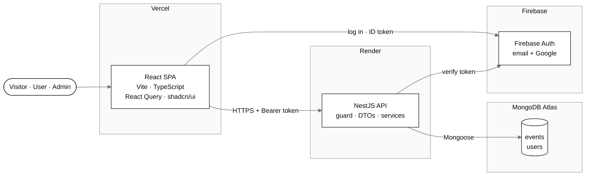
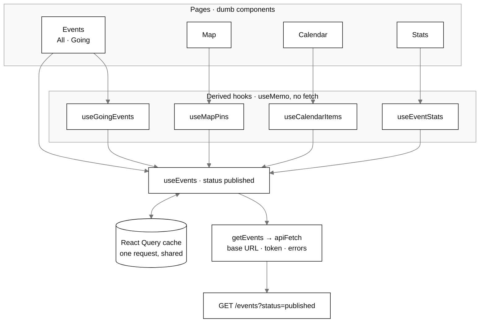
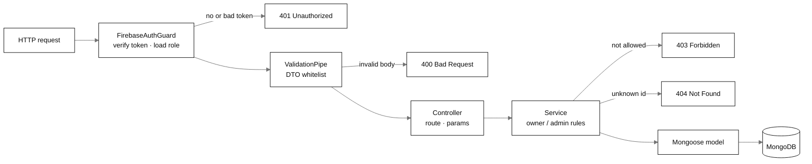
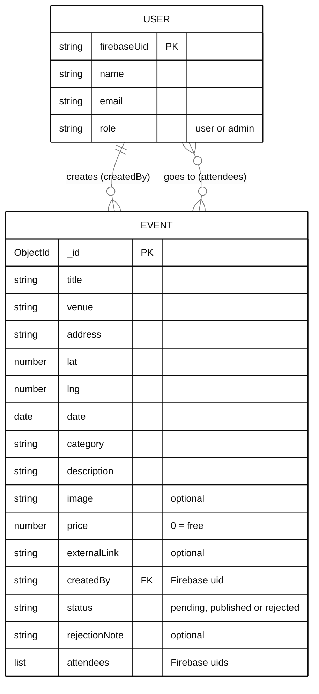
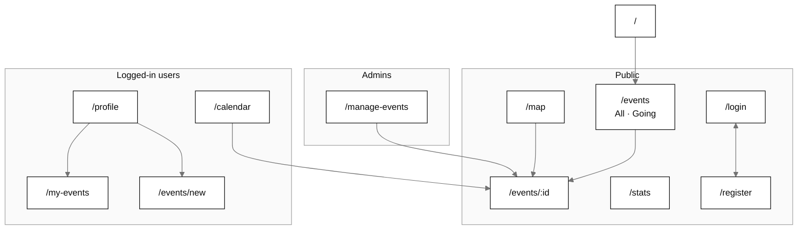
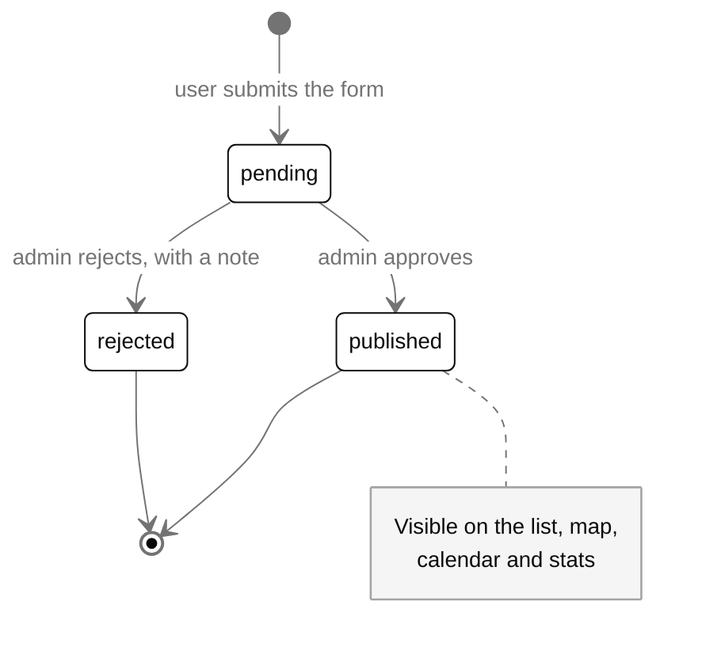
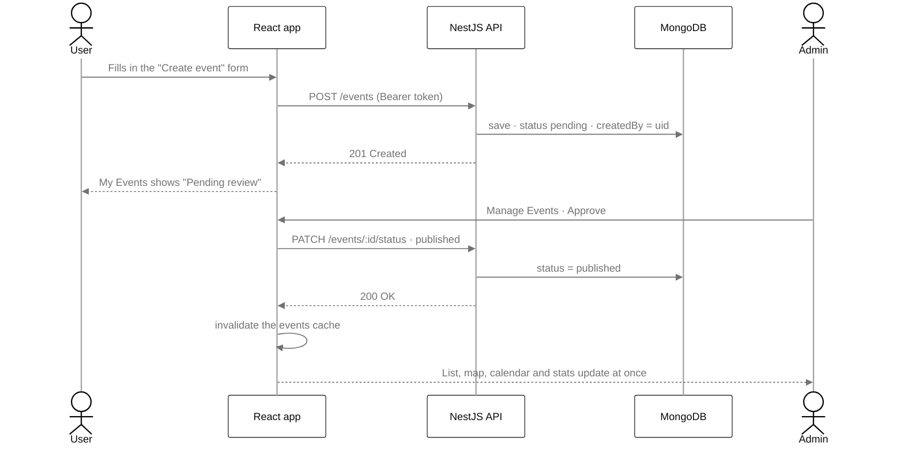
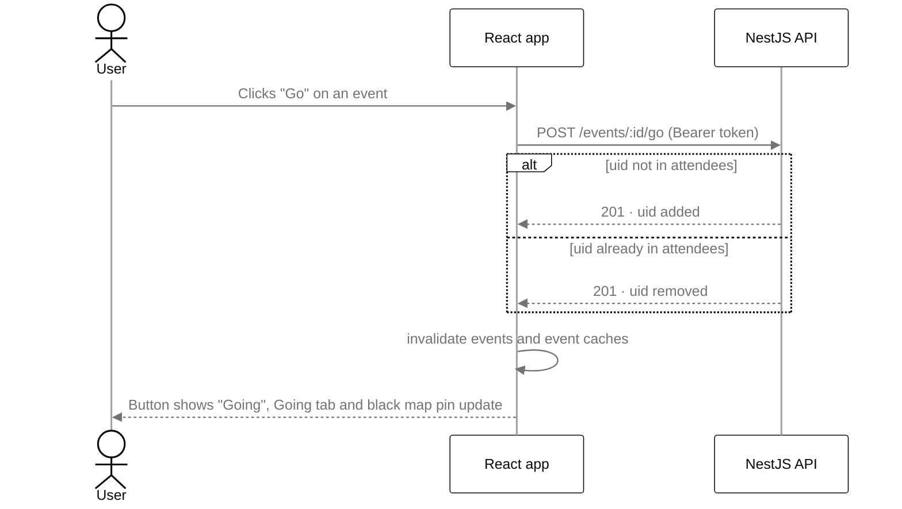

# Art Route

Mobile-first web app to discover **art gallery openings (vernissages) in Barcelona**.
Visitors explore the events on a list, a map, a calendar and a statistics panel.
Logged-in users mark the openings they will go to and submit their own events,
which an admin approves before they are published.

Final project of the Front-End Development bootcamp — IT Academy (Barcelona Activa).

**Live demo:** https://artroute-kappa.vercel.app
**API:** https://artroute.onrender.com/events

> The API runs on Render's free plan: after 15 minutes without use it goes to
> sleep, so the first request can take up to ~50 seconds.

---

## Features

| Who | What they can do |
|---|---|
| **Visitor** | Browse published events as cards, open an event's detail page, see them on the **map** and in the **statistics** panel |
| **Logged-in user** | Register / log in (email + password or Google), mark **Go / Going** on events, see the **Going** tab, the **calendar**, **create events** (they start as *pending*) and follow them in **My Events** (status badges, rejection note) |
| **Admin** | **Manage Events** panel: approve or reject pending events (with an optional note) and see every event with its status |

The same data stays **in sync** everywhere: approving an event makes it appear
on the list, the map, the calendar and the charts at once, without reloading.

## Tech stack

**Frontend** (`frontend/`)
- React 19 + Vite + TypeScript
- React Router (protected and admin-only routes)
- TanStack React Query — single source of truth for server data
- Firebase Auth (email/password + Google)
- Tailwind CSS v4 + shadcn/ui
- Leaflet (react-leaflet) · FullCalendar · Recharts
- Vitest + React Testing Library + vitest-cucumber (Gherkin)

**Backend** (`backend/`)
- NestJS 11 + TypeScript
- MongoDB Atlas + Mongoose
- firebase-admin (verifies the Firebase ID token on every write request)
- class-validator DTOs + global `ValidationPipe`
- Jest + jest-cucumber (Gherkin)

**Deploy:** Vercel (frontend) · Render (backend) · MongoDB Atlas (database)

## Architecture

### System overview



### Frontend data flow

One request feeds the list, the map, the calendar and the charts: they all read
the same React Query cache and transform it with `useMemo`.



Main rules of the project:
1. **No `fetch` inside components.** All server data goes through React Query hooks (`frontend/src/hooks`).
2. **Dumb components, smart hooks.** Components receive props and render; fetching and transforming live in hooks.
3. **No duplicated state.** "Going" events, map pins, calendar items and chart data are **derived with `useMemo`** from the same cached `useEvents()` query — the map, calendar and stats never fetch.
4. **Security lives in the backend.** Hiding a button is UX, not security:
   - `FirebaseAuthGuard` → 401 without a valid token
   - DTO whitelist → users cannot send `status`, `createdBy` or `attendees`
   - owner rule → only the creator or an admin can edit/delete an event (403)
   - only admins can approve or reject (403); roles are stored in MongoDB, never taken from the request

### Backend request pipeline

Every request goes through the same checks, in this order:



### API

| Method | Route | Access | Description |
|---|---|---|---|
| GET | `/events?status=&owner=` | public | List events (sorted by date), optional filters |
| GET | `/events/:id` | public | One event (404 for unknown or invalid ids) |
| POST | `/events` | logged in | Create an event (`status: pending`, `createdBy` = token uid) |
| PATCH | `/events/:id` | owner or admin | Edit an event |
| DELETE | `/events/:id` | owner or admin | Delete an event (204) |
| POST | `/events/:id/go` | logged in | Toggle "Go" (only published events) |
| PATCH | `/events/:id/status` | admin | Publish or reject (+ optional note) |
| GET | `/users/me` | logged in | Current user and role (created on first login) |

### Data model



## Sitemap



## User flows

### Event lifecycle



### Create an event → admin approval → everything in sync



### Mark "Go"



## Project structure

```
artroute/
├── frontend/
│   └── src/
│       ├── api/          # functions that call the API (one per route)
│       ├── components/   # reusable UI (EventCard, EventsMap, EventsCalendar, ...)
│       │   └── ui/       # shadcn/ui components (generated)
│       ├── context/      # AuthContext + AuthProvider (Firebase session)
│       ├── hooks/        # React Query hooks and derived data (useEvents, useMapPins, ...)
│       ├── layouts/      # header + bottom navigation
│       ├── lib/          # apiFetch, Firebase, formatters, counting helpers
│       ├── pages/        # one file per route (+ .feature and .test.tsx files)
│       └── types/        # TypeScript types (ArtEvent, AppUser, ...)
└── backend/
    └── src/
        ├── auth/         # FirebaseAuthGuard (+ Gherkin tests)
        ├── events/       # schema, DTOs, controller, service (+ Gherkin tests)
        ├── users/        # user schema (role), GET /users/me
        └── seed/         # sample data + seed script
```

## Running locally

**Requirements:** Node.js 22+, a MongoDB Atlas cluster and a Firebase project
(Authentication with Email/Password and Google enabled).

### 1. Backend

```bash
cd backend
npm install
cp .env.example .env   # then fill in the values (see below)
npm run seed           # optional: 20 sample events in Barcelona
npm run start:dev      # http://localhost:3000
```

| Variable | Description |
|---|---|
| `MONGODB_URI` | MongoDB Atlas connection string, with the database name `artroute` |
| `PORT` | Port of the API (default 3000) |
| `FRONTEND_URL` | Frontend origin allowed by CORS (`http://localhost:5173`) |
| `FIREBASE_PROJECT_ID` | Firebase project id (to verify ID tokens) |

### 2. Frontend

```bash
cd frontend
npm install
cp .env.example .env   # then fill in the values (see below)
npm run dev            # http://localhost:5173
```

| Variable | Description |
|---|---|
| `VITE_FIREBASE_*` | Firebase web app config (Firebase Console → Project settings) |
| `VITE_API_URL` | URL of the API (`http://localhost:3000`) |

> `VITE_*` variables end up in the browser bundle, so they must never contain
> secrets. The only secret (the MongoDB connection string) lives in the backend.

**Admin role:** every new user is a `user`. To make an admin, change `role` to
`"admin"` in the `users` collection in MongoDB Atlas.

## Scripts

| | Frontend | Backend |
|---|---|---|
| Development | `npm run dev` | `npm run start:dev` |
| Build | `npm run build` | `npm run build` |
| Lint | `npm run lint` | `npm run lint` |
| Tests | `npm test` | `npm test` |
| Other | `npm run preview` | `npm run seed`, `npm run start:prod` |

## Tests

Unit tests with **Gherkin scenarios**: the `.feature` files are executable
(vitest-cucumber in the frontend, jest-cucumber in the backend). External
services (MongoDB, Firebase, the API) are mocked, so the tests are fast and
always give the same result.

- **Backend (16 tests):** event permissions (owner / other user / admin / invalid id),
  auth guard (no token / invalid token / valid token + role), "Go" toggle,
  admin approval (publish, reject with note, forbidden for users, invalid status)
- **Frontend (34 tests):** events page (cards, empty state, Going tab logged in/out),
  register (success, email already in use), NotFound page, date and price formatters

```bash
cd backend && npm test
cd frontend && npm test
```

## Workflow

- **Git Flow:** `main` (production) ← `develop` ← `feature/*`, `chore/*`, `fix/*`, `test/*`, `docs/*`
- One branch and one Pull Request per Trello card; commits follow
  [Conventional Commits](https://www.conventionalcommits.org/) (`feat:`, `fix:`, `chore:`, `test:`, `docs:`)
- Backlog on Trello (board **Art Route**: To Do / In Progress / Done); each card is
  named after its branch, e.g. `[FEATURE] [feature/my-events] My Events page`

## Next steps

- Edit and resubmit a rejected event; edit personal profile data
- Create / edit / delete events directly from the map and the calendar (Level 2)
- Filters by category and date shared by the map, calendar and charts (Level 3)
- "AI Assist" on the create form: clean description and suggested category from pasted text
